# Report AMS Acta

## Documenti per tipologia

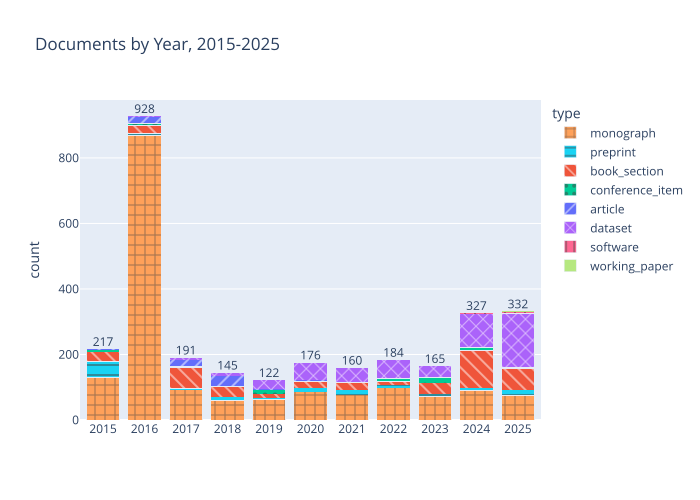

Scarica il file CSV: [documents_2015-2025.csv](out/csv/documents_2015-2025.csv)

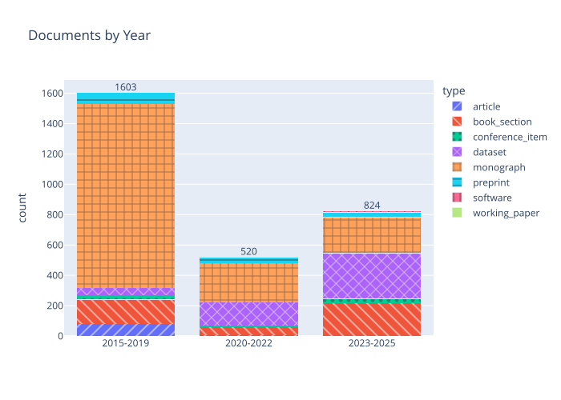

Scarica il file CSV: [documents_2015-2019_2020-2022_2023-2025.csv](out/csv/documents_2015-2019_2020-2022_2023-2025.csv)

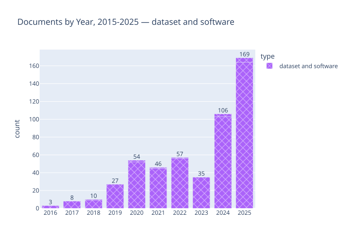

Scarica il file CSV: [documents_2015-2025_dataset_software_.csv](out/csv/documents_2015-2025_dataset_software_.csv)

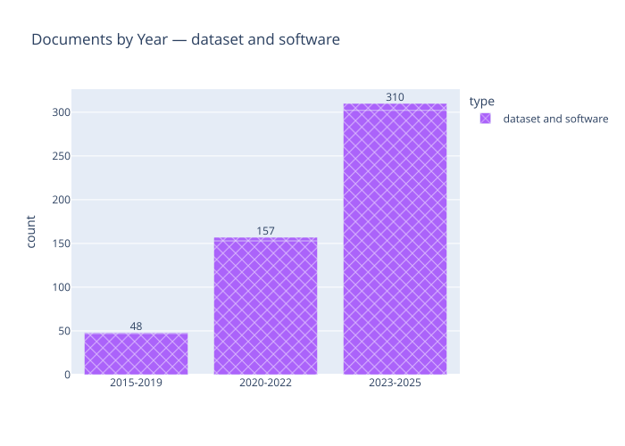

Scarica il file CSV: [documents_2015-2019_2020-2022_2023-2025_dataset_software_.csv](out/csv/documents_2015-2019_2020-2022_2023-2025_dataset_software_.csv)

## Dataset con collegamento a pubblicazione

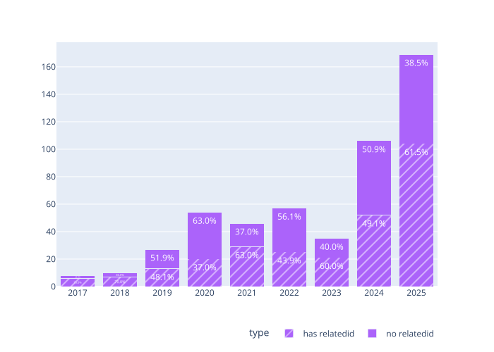

Scarica il file CSV: [relatedid_2017-2025.csv](out/csv/relatedid_2017-2025.csv)

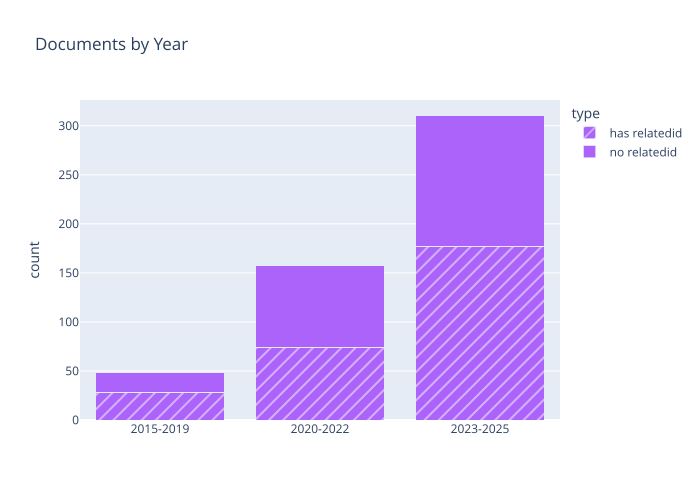

Scarica il file CSV: [relatedid_2015-2019_2020-2022_2023-2025.csv](out/csv/relatedid_2015-2019_2020-2022_2023-2025.csv)

## Volume dei dataset

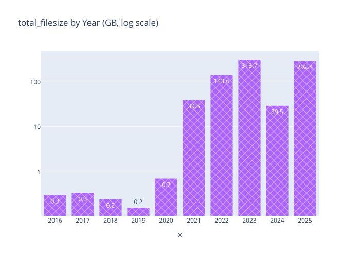

Scarica il file CSV: [total_filesize_2015-2025.csv](out/csv/total_filesize_2015-2025.csv)

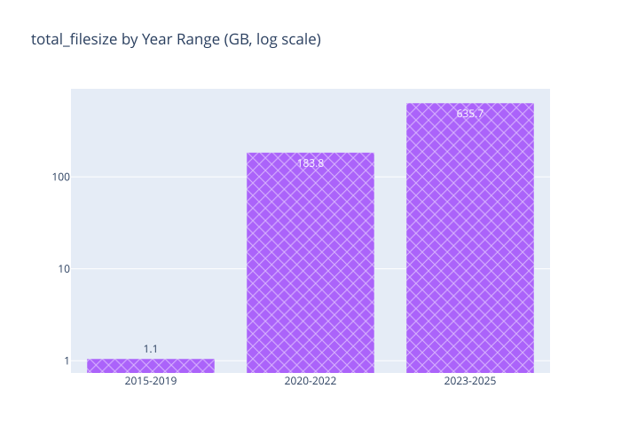

Scarica il file CSV: [total_filesize_2015-2019_2020-2022_2023-2025_.csv](out/csv/total_filesize_2015-2019_2020-2022_2023-2025_.csv)

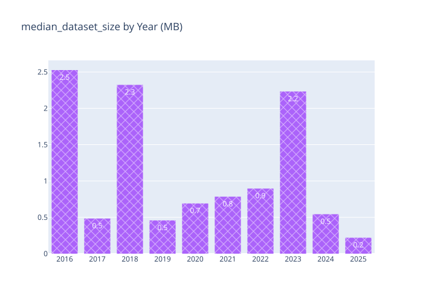

Scarica il file CSV: [median_dataset_size_2015-2025.csv](out/csv/median_dataset_size_2015-2025.csv)

Scarica il file CSV: [median_dataset_size_None-None.csv](out/csv/median_dataset_size_None-None.csv)

## Settori disciplinari

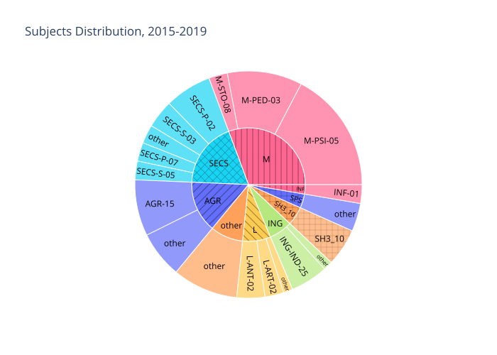

Scarica il file CSV: [subject_2015-2019.csv](out/csv/subject_2015-2019.csv)

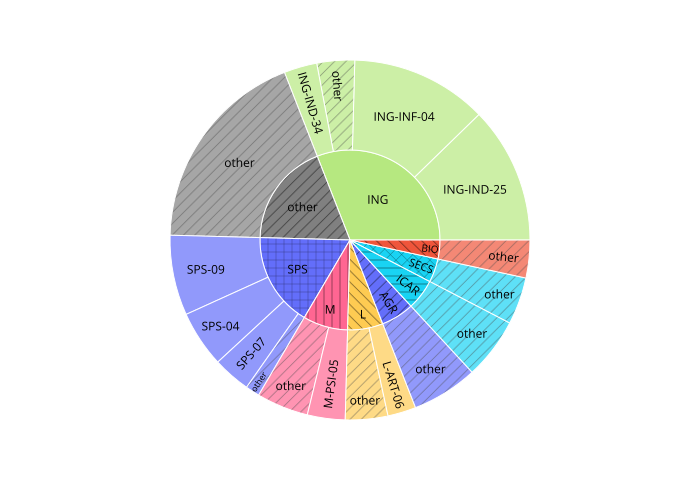

Scarica il file CSV: [subject_2020-2022.csv](out/csv/subject_2020-2022.csv)

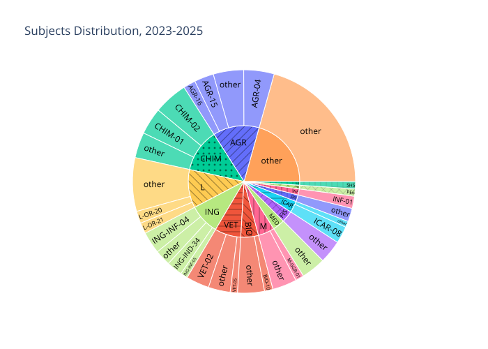

Scarica il file CSV: [subject_2023-2025.csv](out/csv/subject_2023-2025.csv)

## Strutture (dataset e software)

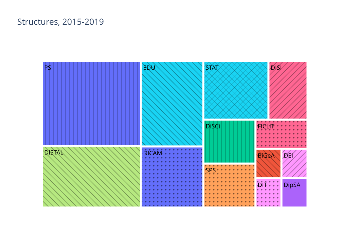

Scarica il file CSV: [structure_2015-2019.csv](out/csv/structure_2015-2019.csv)

Scarica il file CSV: [structure_2020-2022.csv](out/csv/structure_2020-2022.csv)

Scarica il file CSV: [structure_2023-2025.csv](out/csv/structure_2023-2025.csv)

## Progetti

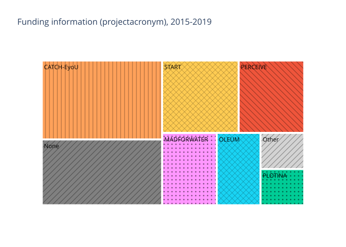

Scarica il file CSV: [projectacronym_2015-2019.csv](out/csv/projectacronym_2015-2019.csv)

Scarica il file CSV: [projectacronym_2020-2022.csv](out/csv/projectacronym_2020-2022.csv)

Scarica il file CSV: [projectacronym_2023-2025.csv](out/csv/projectacronym_2023-2025.csv)
