# Report AMS Acta

## type distribution, 2016-2025
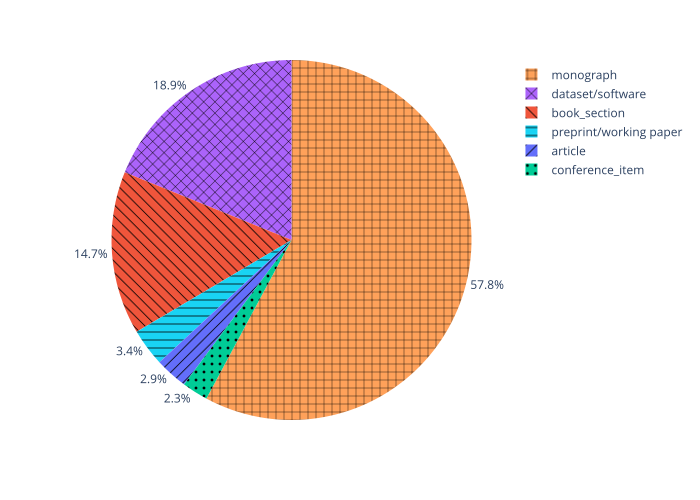

Scarica il file CSV: [pie_type_2016-2025.csv](out/csv/pie_type_2016-2025.csv)

## documents by year, 2016-2025
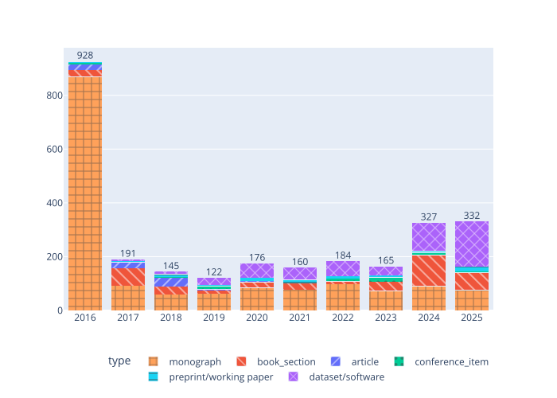

Scarica il file CSV: [documents_2016-2025.csv](out/csv/documents_2016-2025.csv)

## Documents by year, 2016-2019, 2020-2022, 2023-2025
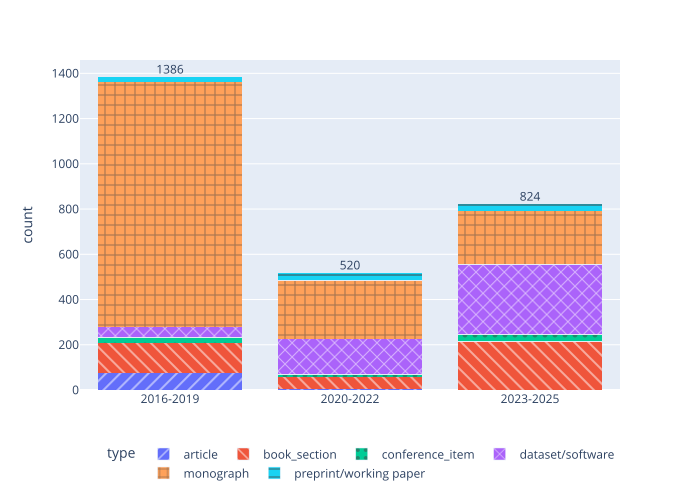

Scarica il file CSV: [documents_2016-2019_2020-2022_2023-2025.csv](out/csv/documents_2016-2019_2020-2022_2023-2025.csv)

## documents by year, 2016-2025 — dataset/software
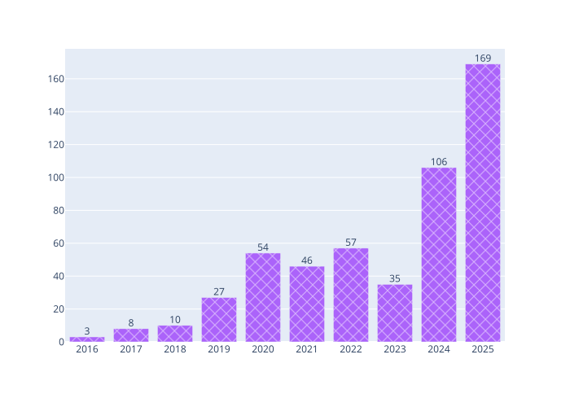

Scarica il file CSV: [documents_2016-2025_dataset-software_.csv](out/csv/documents_2016-2025_dataset-software_.csv)

## Documents by year, 2016-2019, 2020-2022, 2023-2025 — dataset/software
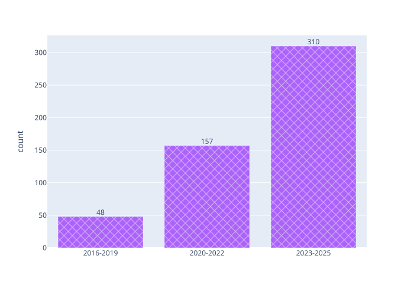

Scarica il file CSV: [documents_2016-2019_2020-2022_2023-2025_dataset-software_.csv](out/csv/documents_2016-2019_2020-2022_2023-2025_dataset-software_.csv)

## total_filesize by year (GB), log scale
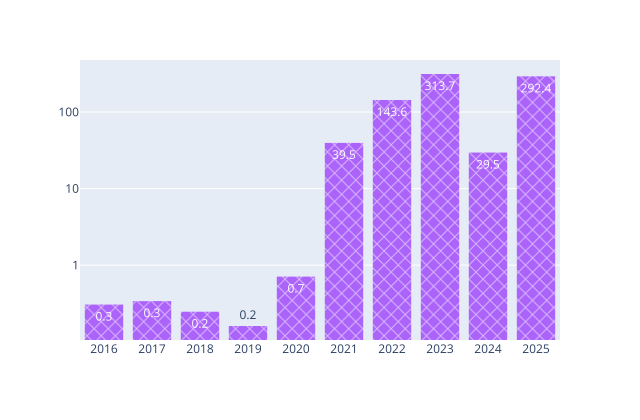

Scarica il file CSV: [total_filesize_2016-2025.csv](out/csv/total_filesize_2016-2025.csv)

## total_filesize by year range, 2016-2019, 2020-2022, 2023-2025 (GB, log scale)
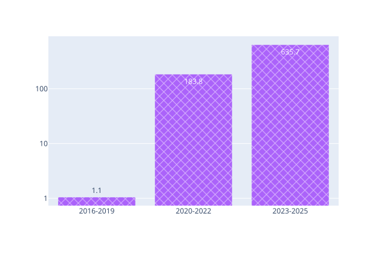

Scarica il file CSV: [total_filesize_2016-2019_2020-2022_2023-2025_.csv](out/csv/total_filesize_2016-2019_2020-2022_2023-2025_.csv)

## median_dataset_size by year (MB)
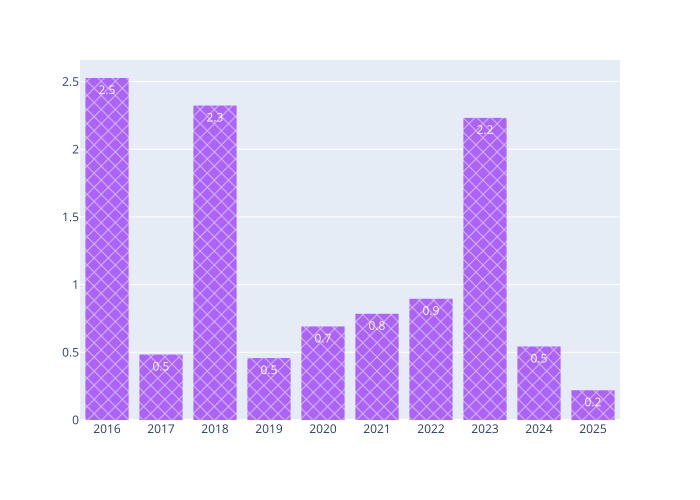

Scarica il file CSV: [median_dataset_size_2016-2025.csv](out/csv/median_dataset_size_2016-2025.csv)

## median_dataset_size by year_range (MB)
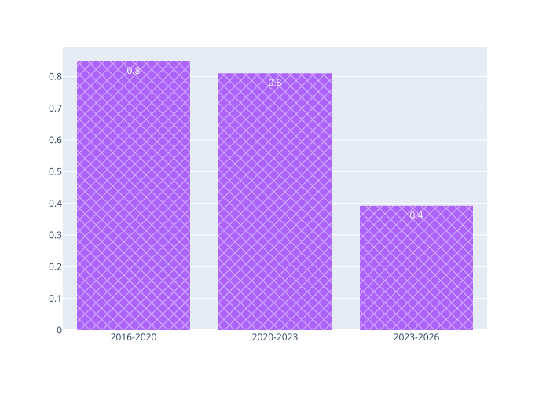

Scarica il file CSV: [median_dataset_size_None-None.csv](out/csv/median_dataset_size_None-None.csv)

## relatedid by year, 2016-2025
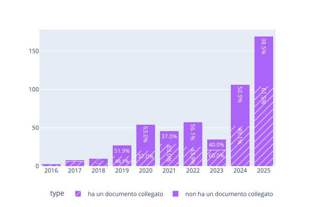

Scarica il file CSV: [relatedid_2016-2025.csv](out/csv/relatedid_2016-2025.csv)

## Documents by year, 2016-2019, 2020-2022, 2023-2025
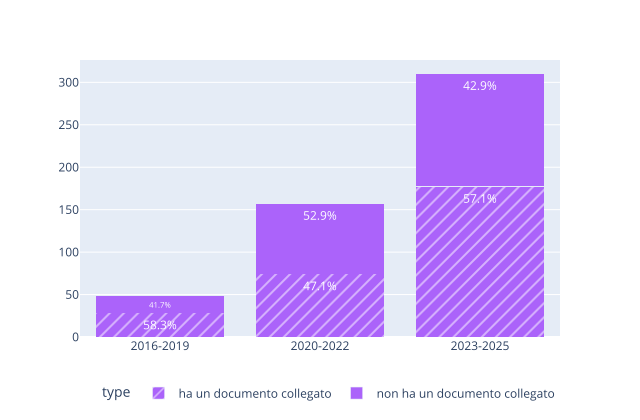

Scarica il file CSV: [relatedid_2016-2019_2020-2022_2023-2025.csv](out/csv/relatedid_2016-2019_2020-2022_2023-2025.csv)

## Subjects distribution, 2016-2019 (threshold: 1)
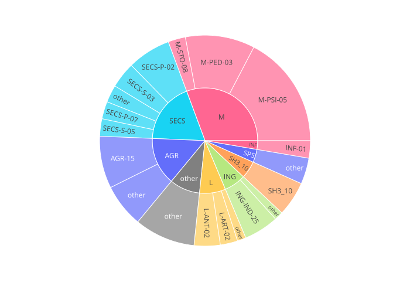

Scarica il file CSV: [subject_2016-2019_no-pattern.csv](out/csv/subject_2016-2019_no-pattern.csv)

## Subjects distribution, 2020-2022 (threshold: 5)
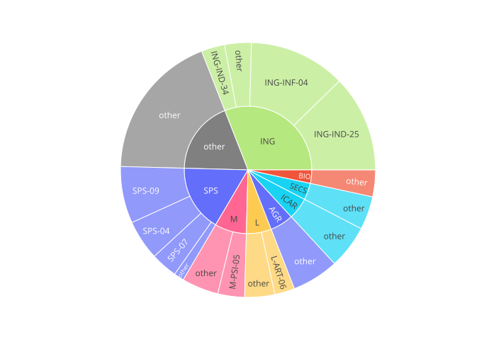

Scarica il file CSV: [subject_2020-2022_no-pattern.csv](out/csv/subject_2020-2022_no-pattern.csv)

## Subjects distribution, 2023-2025 (threshold: 5)
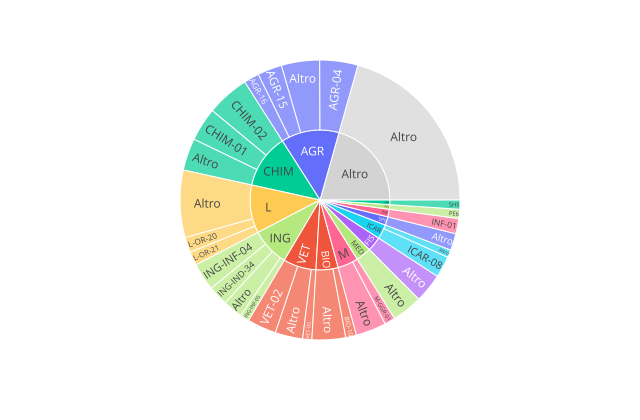

Scarica il file CSV: [subject_2023-2025_no-pattern.csv](out/csv/subject_2023-2025_no-pattern.csv)

## Structures, 2016-2019 (threshold = 0)
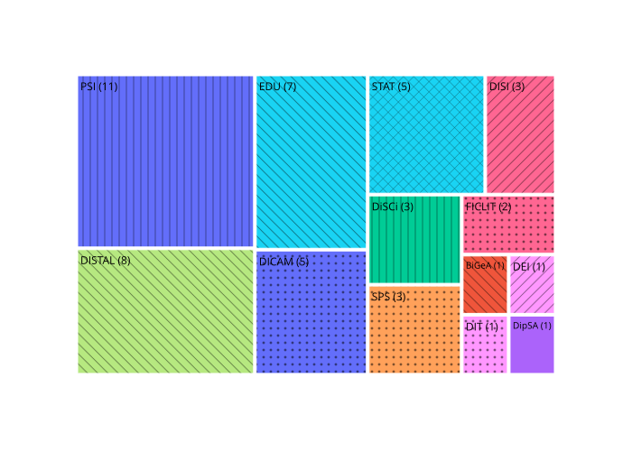

Scarica il file CSV: [structure_2016-2019.csv](out/csv/structure_2016-2019.csv)

## Structures, 2020-2022 (threshold = 0)
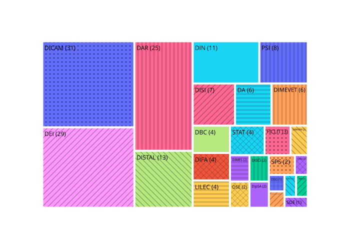

Scarica il file CSV: [structure_2020-2022.csv](out/csv/structure_2020-2022.csv)

## Structures, 2023-2025 (threshold = 0)
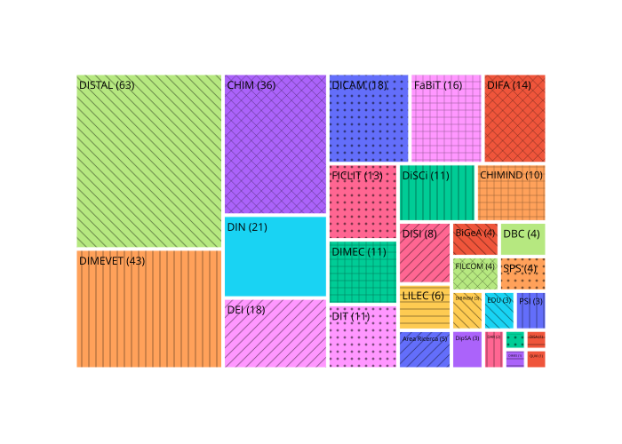

Scarica il file CSV: [structure_2023-2025.csv](out/csv/structure_2023-2025.csv)

## Funding information (projectacronym), 2016-2019 (threshold = 1)
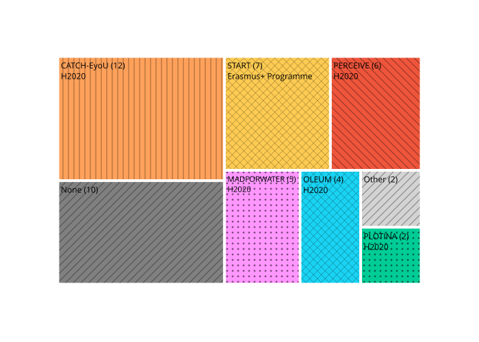

Scarica il file CSV: [projectacronym_2016-2019.csv](out/csv/projectacronym_2016-2019.csv)

## Funding information (projectacronym), 2020-2022 (threshold = 1)
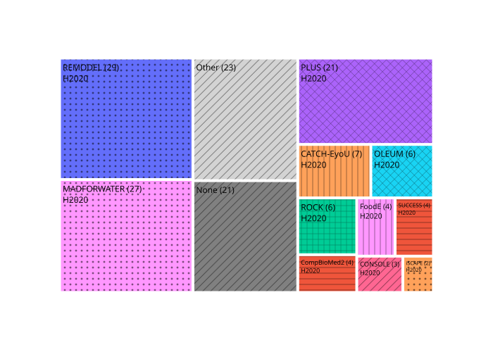

Scarica il file CSV: [projectacronym_2020-2022.csv](out/csv/projectacronym_2020-2022.csv)

## Funding information (projectacronym), 2023-2025 (threshold = 2)
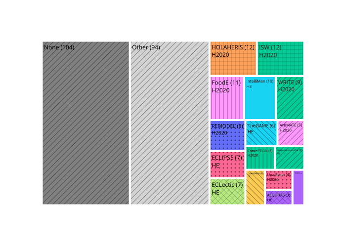

Scarica il file CSV: [projectacronym_2023-2025.csv](out/csv/projectacronym_2023-2025.csv)

## no_fund_relatedid by year, 2023-2025
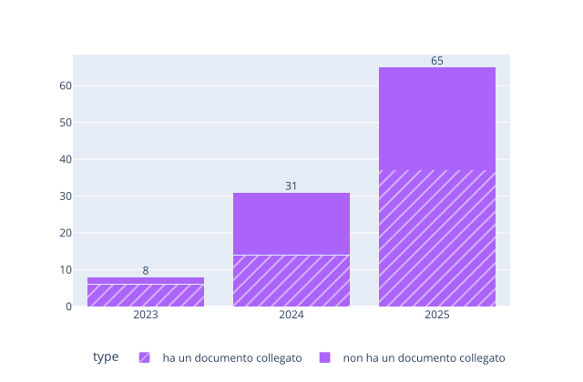

Scarica il file CSV: [no_fund_relatedid_2023-2025.csv](out/csv/no_fund_relatedid_2023-2025.csv)
